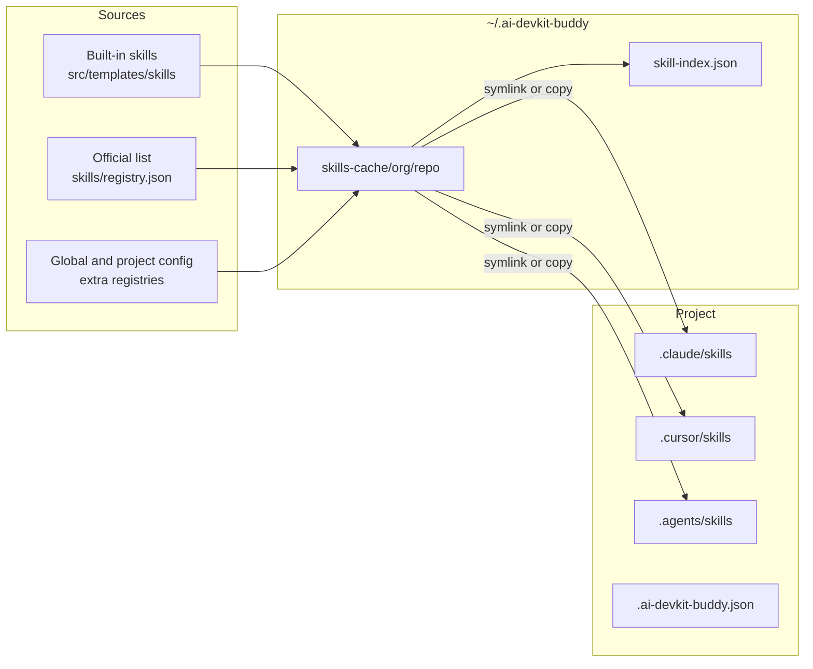

# Architecture of the skill package manager

`ai-devkit-buddy` finds, installs, and shares agent skills across Claude Code, Cursor, and OpenAI Codex. This page explains how the pieces fit and why they are shaped the way they are. For commands and flags, see the [README](../README.md).

## Four ideas carry the whole design

- A **skill** is a folder with a `SKILL.md` file. The frontmatter holds `name` and a `description` that says what the skill does and when an agent should use it.
- A **registry** is any git repo or local folder that contains `skills/<name>/SKILL.md`.
- The **built-in skills** are one more registry, `linhvuquach/ai-devkit-buddy`, whose content is `src/templates/skills` inside this package. No code path treats them specially.
- The **project config**, `.ai-devkit-buddy.json`, records the agents and skills a project uses. It is the contract that lets a teammate reproduce the setup with `ai-devkit-buddy install`.

## Code is layered so commands stay thin

Each layer depends only on the layers below it.

| Layer | Location | Job |
|---|---|---|
| Commands | `src/cli.ts`, `src/commands/` | Parse flags with `commander`, call one service, render the result. No business logic. |
| Services | `src/services/skill/`, `src/services/install/` | Registry merging and preparation, discovery, the search index, and the installer. |
| Config | `src/lib/` | Read, parse, and write the project config and the global config. |
| Utilities | `src/util/` | The agent table, git, filesystem helpers, errors, and terminal output. All third-party IO lives here. |
| Domain types | `src/types.ts`, `src/constants.ts` | Shared data shapes and every name, path, limit, and environment-variable override. |

Inside services, each module owns one body of knowledge:

- `registry/registry-source.ts` turns a source string into a typed `RegistrySource` and makes the registry available on disk.
- `registry/registry.service.ts` merges the registry lists from every scope.
- `registry/registry-discovery.ts` lists the valid skills in a registry and enforces the security limits.
- `index/index.service.ts` builds, refreshes, and searches the skill index.
- `installer/installer.service.ts` links or copies skills into agent folders and updates the project config.
- `install/install.service.ts` replays a project config.

## Three flows cover most use

### Installing a skill

1. `skill add <registry> <name>` validates the registry id and the skill name.
2. The installer resolves the target agents from `--env` or the project config.
3. `fetchMergedRegistry` builds the registry map. Later scopes win: built-in, then `skills/registry.json`, then the global config, then the project config.
4. `prepareRegistry` puts the registry on disk and returns its root.
5. `resolveContainedSkill` confirms that the skill folder stays inside the registry.
6. For each agent folder, the installer creates a symlink to the cached skill. If a symlink fails, it copies instead.
7. The installer upserts the skill into `.ai-devkit-buddy.json`. Global installs are not recorded.

### Searching for a skill

`skill find` loads `~/.ai-devkit-buddy/skill-index.json` and ranks matches. An exact name match ranks first, then a name prefix, then a name substring, then a description substring. The command prints a table with the skill name, the registry, and a description cut at 60 characters, then the `skill add` command for each shown row. `--limit` only changes how many rows are shown. The count is the full number of matches. `--all` shows every row.

On a fresh machine the local index does not exist yet, so search starts from `skills/index.json`, which ships in the package and covers every official registry. When a local index already exists, registries that machine has scanned keep their local rows, and registries it has never scanned are filled in from the bundled index. If the index is younger than 24 hours, only local and bundled registries are rescanned. If it is older, every registry that is already cached is pulled. A registry is rescanned only when its git `HEAD` changed. `--refresh` also clones registries that are not cached yet. A registry that fails to clone keeps its previous entries and produces a warning, so one broken repo never blocks search.

### Listing installed skills

`skill list` scans the skill folders of the agents in the project config. It prints one row per skill that is actually on disk. A skill recorded in the config but missing from disk does not appear. A skill on disk that is not in the config does appear. The registry cell comes from the config when the name is listed there. Otherwise it is read from the folder path. Both the bundled cache and a cache laid out as `<org>/<repo>/skills/<name>` yield `org/repo`. Anything else is `unknown`. The environments cell is the project's configured agents, the same list on every row.

`skill list <registry>` is a different question. It prepares that registry and prints the skills it offers, so you can pick a name before `skill add`.

### Reproducing a project

`install` reads the project config, or another file with `-c`, and runs the installer for every recorded skill across every recorded agent. It prints a report and exits non-zero on any failure or conflict, so it can run in CI.

## Design decisions and why

**Registry sources are one of three kinds.** A source is `git`, `local`, or `bundled`, and each kind has one way to prepare it. Parsing happens once, when the config is read. Later code never guesses what a string means.

| Kind | Example source | How it is prepared |
|---|---|---|
| `git` | `https://github.com/anthropics/skills.git` | A shallow, sparse clone of only `skills/` into `skills-cache/<org>/<repo>`. Later runs fetch and reset. |
| `local` | `./my-skills`, `file:///abs/path` | Used in place. |
| `bundled` | the package's `src/templates` | Copied into `skills-cache/linhvuquach/ai-devkit-buddy`. |

**Bundled skills are copied before they are linked.** A symlink straight into the package would break when `npx` clears its cache or `node_modules` is reinstalled. The cache copy is stable. Each install, search, or update refreshes it, so a package upgrade updates the built-in skills in every project.

**Symlinks are the default.** All projects link to one cached copy, so `skill update` refreshes every project at once. Use `--mode copy` when a project needs its own editable copy.

**Existing installs are never overwritten.** An existing target folder may hold local edits, so the installer skips it. The one exception is a copy requested over a symlink. That is reported as a conflict, and `--overwrite` resolves it. A conflicted install does not change the mode recorded in the config, so the config always matches what is on disk.

**Clones are sparse.** Several official registries are large product repos. Fetching only `skills/` keeps installs and index builds small. For example, the `anthropics/skills` cache is about 16 MB.

**The agent table is data.** `src/util/env.ts` holds one row per agent:

| Code | Agent | Project folder | Global folder (under `~`) |
|---|---|---|---|
| `claude` | Claude Code | `.claude/skills` | `.claude/skills` |
| `cursor` | Cursor | `.cursor/skills` | `.cursor/skills` |
| `codex` | OpenAI Codex | `.agents/skills` | `.codex/skills` |

The installer reads paths from this table and never branches on the agent. Claude Code and Cursor also have a `commandPath`, which `init` uses to copy the command templates from `src/templates/commands`.

**External data is parsed at the edge.** Config files, `skills/registry.json`, the index file, and CLI flags are parsed into the types in `src/types.ts` where they enter the program. The parser also accepts the old tracker format of `.ai-devkit-buddy.json` (`"environment": "both"`) and rewrites it in the new shape on the next save.

**The index is derived data.** You can delete `skill-index.json` at any time. The next search rebuilds it. `skill rebuild-index --output <file>` writes a fresh index for publishing.

## Guards against hostile registries

A registry is code you did not write, so every path that reaches the filesystem is checked:

- Skill names must match `^[a-z0-9]+(-[a-z0-9]+)*$`. Registry ids must look like `org/repo` and cannot contain `..` or `~`.
- A skill folder, after following symlinks, must stay inside the registry's `skills/` folder.
- `SKILL.md` must be a regular file under 1 MB. A registry with more than 10,000 entries in `skills/` is rejected.
- Copy installs skip any nested file that resolves outside the skill folder. This stops a registry from copying a file such as `~/.ssh/id_rsa` into your project.
- Global removal checks that the target stays inside the agent's global skill folder.
- Git runs through `execFile` with an argument list, never through a shell.

## Where the design grows

- **A new agent** needs one row in the agent table, one member in the `EnvironmentCode` union, and a test.
- **A new registry** needs only an entry in `skills/registry.json` or a config file. No code changes.
- **A new kind of source**, such as an npm tarball, needs a new `RegistrySource` member and one more case in `prepareRegistry`. The installer only needs a local folder, so it stays unchanged.
- **A fresher shipped index** is the next step. The `Rebuild Skill Index` workflow (`.github/workflows/index.yml`) commits `skills/index.json` when registry content changes, but npm users get the new file only with the next release. Fetching the committed file from GitHub on a fresh machine would close that gap.
- **Larger indexes** can swap the linear search in `rankSkills` for an inverted index behind the same `findSkills` signature.

## Global state lives in one folder

`~/.ai-devkit-buddy` holds `skills-cache/`, `skill-index.json`, and `config.json`, the global registry list. Set `AI_DEVKIT_BUDDY_HOME` to move it, which the tests do to stay isolated. `AI_DEVKIT_BUDDY_INDEX_TTL_MS` changes the 24-hour index lifetime. `AI_DEVKIT_BUDDY_OFFICIAL_REGISTRIES` points at a different registry list.
